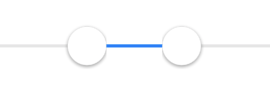

# SDRangeSlider 


## Introduce
* Easy-to-use iOS range slider selector


## Import
- Drag floder `SDRangeSlider` to your project.
```objc
#import "SDRangeSlider.h"
```
## CocoaPods
```
pod 'SDRangeSlider'
```

## Quick View
```objc
SDRangeSlider* slider = [[SDRangeSlider alloc] initWithFrame:CGRectMake(0, 0, 300, 30)];
[slider eventValueDidChanged:^(SDRangeSliderValues *values) {
    double left = values.left.doubleValue;
    double right= values.right.doubleValue;
}];
[self.view addSubview:slider];

//others
//    slider.minimumSize = 10;
//    slider.offsetOfAdjustLineStart = -12;//look at viewHierarcy
//    slider.offsetOfAdjustLineEnd = 15;//look at viewHierarcy
//    [slider usingValueUnequal];
//    [slider update];//May be used in autolayout, layoutSubviews:... ...
//    ... ...
```
### Support xib
- Better to call `update` when constraints layout.

---
More code in demo
